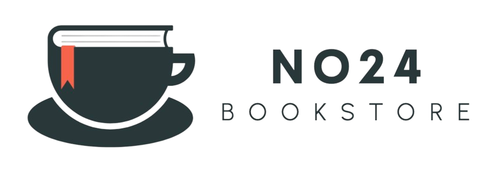

# 강병구 · byegu

Java와 Spring으로 웹 서비스의 접근 권한, 조회 API, 외부 서비스 연동을 구현했습니다.

## 대표 프로젝트

### 도담 · 그림 활동 기록과 분석 보고서

**백엔드 · 2026.07–08** 
보호자와 아동의 관계를 검증하고, 분석 서비스에 이미지를 60초 동안 한 번만 열 수 있게 했습니다. 분석 응답의 ID와 필수 값을 확인하고, 보고서 생성에 실패해도 완료된 그림 활동은 유지하도록 처리했습니다.

[구현 설명](projects/dodam.md) · [분석 클라이언트](https://github.com/byegu/dodam/blob/main/backend/src/main/java/com/ssafy/b209/infrastructure/ai/drawing/RestClientDrawingAnalysisClient.java) · [테스트](https://github.com/byegu/dodam/blob/main/backend/src/test/java/com/ssafy/b209/infrastructure/ai/drawing/RestClientDrawingAnalysisClientTest.java)

### 불러요 · 공동 공연 예매와 수익 정산

**프런트엔드·팀장 · 2026.08–10** 
테스트넷 시연 서비스에서 지갑 서명과 결제 상태를 화면에 연결했습니다. 결제 성공을 확인한 뒤 완료 화면으로 이동하고, 재시도 전에는 주문과 결제 상태를 다시 조회하도록 구현했습니다.

[구현 설명](projects/bulleoyo.md) · [결제 화면](https://github.com/byegu/bulleoyo/blob/main/frontend/src/pages/PaymentPage.tsx) · [테스트](https://github.com/byegu/bulleoyo/blob/main/frontend/src/pages/PaymentPage.live.test.tsx)

### No24 · 온라인 도서 쇼핑몰

**백엔드 · 2024.03–05** 
카테고리의 상하위 관계를 모델링하고, 목록과 상세 화면에 필요한 조회 응답을 나눴습니다. QueryDSL로 조회를 구현하고 계층별 테스트를 작성했습니다.

[구현 설명](projects/no24.md) · [카테고리 서비스](https://github.com/nhnacademy-be5-no24/no24-shop/blob/develop/src/main/java/com/nhnacademy/shop/category/service/impl/CategoryServiceImpl.java) · [테스트](https://github.com/nhnacademy-be5-no24/no24-shop/blob/develop/src/test/java/com/nhnacademy/shop/category/controller/CategoryControllerTest.java)

## 기술과 학습

- **백엔드** Java, Spring Boot, Spring Security, JPA, QueryDSL
- **데이터·검색** MySQL, Redis, Elasticsearch
- **프런트엔드** React, TypeScript
- **자격** 정보처리기사, SQLD
- [Java 알고리즘 풀이](https://github.com/byegu/Algorithm) · [solved.ac](https://solved.ac/profile/rkdqudrn07)

수상·어학·기타 활동

- 도담 · SSAFY 공통 프로젝트 우수상 (팀)
- No24 · SW아카데미 NHN Academy 프로젝트 최종발표회 대상 (팀)
- ROADAI · 2024 한국소프트웨어종합학술대회 학부생/주니어 논문경진대회 장려상 (공동저자, 2025.02.03)
- TOEIC Speaking IH
- SSAFY SW 역량평가 A등급 (2026.03.06)

GitHub 활동 기록

<picture>
  <source media="(prefers-color-scheme: dark)" srcset="assets/activity-dark.svg">
  <source media="(prefers-color-scheme: light)" srcset="assets/activity-light.svg">
  
</picture>
<a href="https://github.com/Platane/snk">snk</a> 사용.

