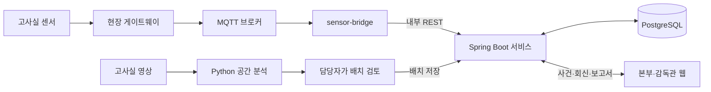

# Signull | 시험장 무선 신호 관측과 현장 확인 지원

시험 본부가 고사실 주변의 BLE·Wi-Fi 관측과 후보 구역을 보고, 담당 감독관에게 확인을 요청한 뒤 그 결과를 교시 보고서에 남기는 서비스입니다.

| 기간 | 팀 | 담당 |
| --- | --- | --- |
| 2026년 10~11월 | SSAFY 자율 프로젝트 · 6인 | 백엔드, 본부·감독관 화면 연동 협업 |

**스택** Java 21 · Spring Boot · PostgreSQL · Flyway · React · TypeScript · Python · MQTT · Docker Compose · GitLab CI

## 어떤 문제를 풀었나

무선 관측에는 잡음이 있고, 신호를 확인한 사람과 실제 고사실을 확인하는 사람은 다릅니다. 시험 준비 단계에서는 고사실 배치와 담당자를 정합니다. 시험 중에는 관측을 토대로 후보 구역을 제시하고 담당자가 현장을 확인합니다. 종료 뒤에는 본부가 처리 결과와 미처리 내역을 교시별로 살펴볼 수 있습니다.

## 데이터와 요청의 흐름

영상 경로는 고사실 배치의 초안을 만드는 데 쓰입니다. 센서 경로는 무선 관측을 수집합니다. 본부와 감독관은 웹에서 시험·배치·사건 상태를 확인합니다. 후보 위치는 감독관이 확인할 구역을 좁히는 단서로 보여 줍니다.

## 백엔드에서 맡은 일

### 센서 메시지를 재전송했을 때 저장 경로 확인

- **문제** · 게이트웨이·브리지·Spring 개발이 병행돼 전달 형식이 달라지면 저장이 막힐 수 있었습니다. 로그를 다시 보낼 경우 같은 관측이 중복으로 쌓이거나 장비 상태에 영향을 줄 수 있었습니다.
- **내 역할** · MQTT 구독 측이 내부 REST로 데이터를 넘기고, Spring이 검증·저장을 맡는 안을 선택하는 데 참여했습니다. 메시지 계약을 먼저 맞추고 저장과 재생 경로를 검증하는 순서를 잡았습니다.
- **팀 구현** · sensor-bridge가 MQTT를 구독해 전달합니다. Spring은 배치 재전송과 원본 행 중복을 별도로 검사합니다. 원본 행은 게이트웨이·파일·줄 번호로 식별합니다. REPLAY는 관측 시각과 원본의 파일·줄 번호를 보존하고 장비 생존 상태를 갱신하지 않습니다.
- **확인 범위** · Codex·Claude를 활용한 개발 과정에서, 로컬 MQTT와 PostgreSQL을 연결해 같은 합성 입력을 두 번 보냈습니다. 첫 실행에서 저장된 관측이 두 번째 실행에 다시 쌓이지 않았고, 거부 입력과 장비 상태도 확인했습니다.

### 감독관의 권한은 시험과 배정 고사실 기준으로

- **문제** · 같은 감독관이라도 시험마다 배정 범위가 다릅니다. 본부와 감독관을 브라우저 두 탭에서 점검하던 중 두 번째 로그인이 다른 탭의 상태를 덮어쓰는 증상도 관찰했습니다.
- **내 역할** · 기관 계정이 본부 역할을 맡도록 정리하고, 초대·등록·승인·고사실 배정이 저장되고 권한에 이어지는지 개발 DB까지 확인하도록 요청했습니다. 탭 충돌의 재현 조건을 공유하고, 테스트 계정 조회 결과에서 후속 변경 대상을 배정 변경으로 좁혔습니다.
- **팀 구현과 확인** · 서버는 승인 상태와 현재 시험의 고사실 배정을 기준으로 업무 요청을 검사합니다. 프런트의 탭별 세션은 두 역할을 한 창에서 점검할 때의 로그인 상태를 분리합니다. 개발 검증에서 승인 대기, 미배정 고사실, 이전 시험 접근 거부와 두 탭의 독립 로그아웃을 확인했습니다.

### 교시가 끝난 뒤 도착한 회신을 보고서에 반영

- **문제** · 실제 현장을 확인한 사람은 고사실 감독관인데 결과를 본부가 다시 입력하는 흐름이 있었습니다. 교시 종료 시점까지 회신이 오지 않은 사건도 남을 수 있었습니다.
- **내 역할** · 감독관이 보내는 결과를 저장하고 본부는 그 기록을 확인하도록 제안했습니다. 팀원이 보고서 화면을 작업하는 동안, 종료 처리와 미처리 사건부터 확인하도록 검증 순서를 잡았습니다.
- **팀 구현과 확인** · 교시 종료가 커밋된 뒤 별도 트랜잭션에서 보고서를 생성해, 생성에 실패해도 종료 기록을 유지합니다. 사건·조치·센서 장애 등의 원천 기록이 바뀌었는지 해시를 비교하고, 바뀐 경우 기존 보고서를 보존한 채 개정판을 추가합니다. 개발 환경에서 늦은 회신을 반영한 보고서 개정판이 조회된 기록이 있습니다.

## 추가 검증과 회고

| 검증 | 확인한 내용 |
| --- | --- |
| 영상 배치 저장 | 영상 분석 중 홈 이동과 복귀, 배치 저장, PostgreSQL 변경, 본부 화면 표시를 대조하도록 검증 시나리오를 지정했습니다. Codex 실행 기록에서 첫 시도는 교체 확인창에서 저장 요청 전에 멈췄고, 재실행에서는 저장과 화면 반영까지 확인됐습니다. |
| 교시 상태 | 명령 접수와 분석 서버의 적용 확인(ACK)을 구분했습니다. 실제 PostgreSQL과 HTTP 모의 분석 서버로 상태 전이 테스트가 실행된 기록이 있습니다. |
| 백엔드 CI | 기존 팀 CI에서 실제 PostgreSQL 검증과 원본 테스트 결과까지 확인하도록 요구했습니다. Windows의 소켓 오류는 애플리케이션 실행과 분리해 진단했고, 검증에는 팀원과 AI 도구가 참여했습니다. |

화면을 넘나드는 기능을 검증할 때는 먼저 확인할 상태를 정했습니다. 예를 들어 배치 저장의 완료 기준에는 화면 표시와 DB 변경을 함께 넣었습니다. 다시 설계한다면 저장·권한·개정 조건을 표로 먼저 합의하고, 같은 조건을 서버 테스트와 화면 검증에 함께 쓰겠습니다.

검증은 합성 입력, 테스트 계정 및 개발 환경에서 수행했습니다. 팀의 장비 예비 관측은 별도 기록입니다.
